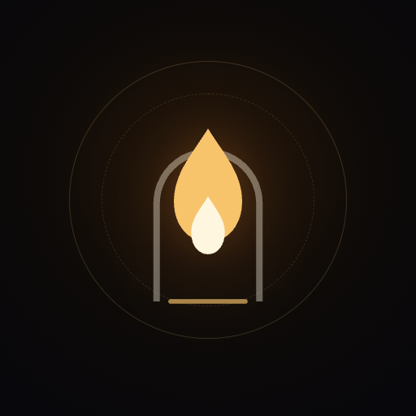
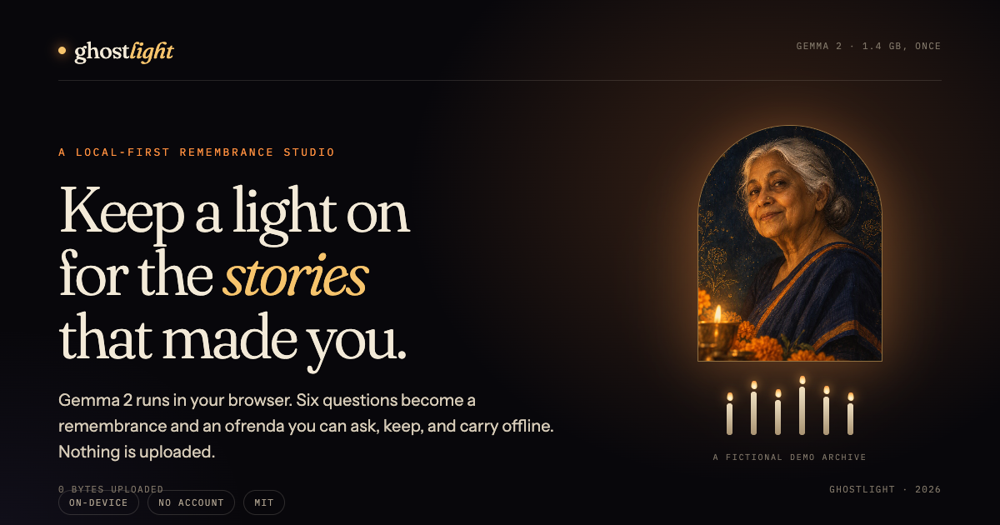
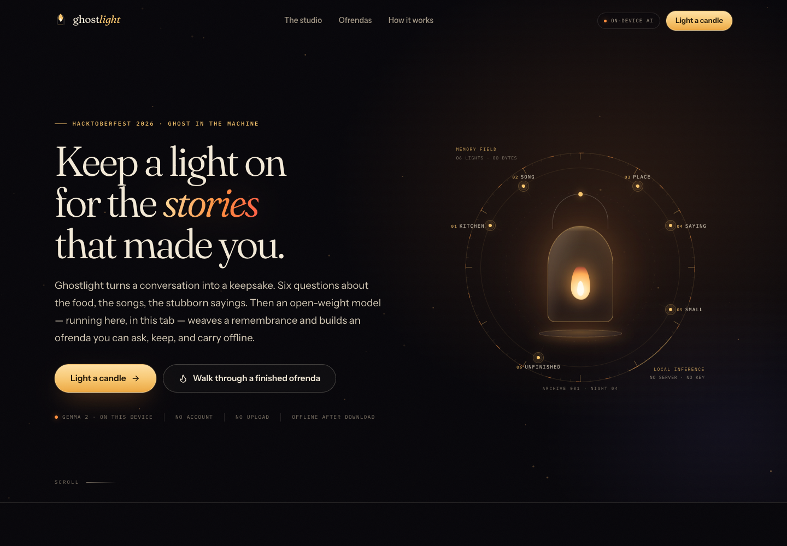
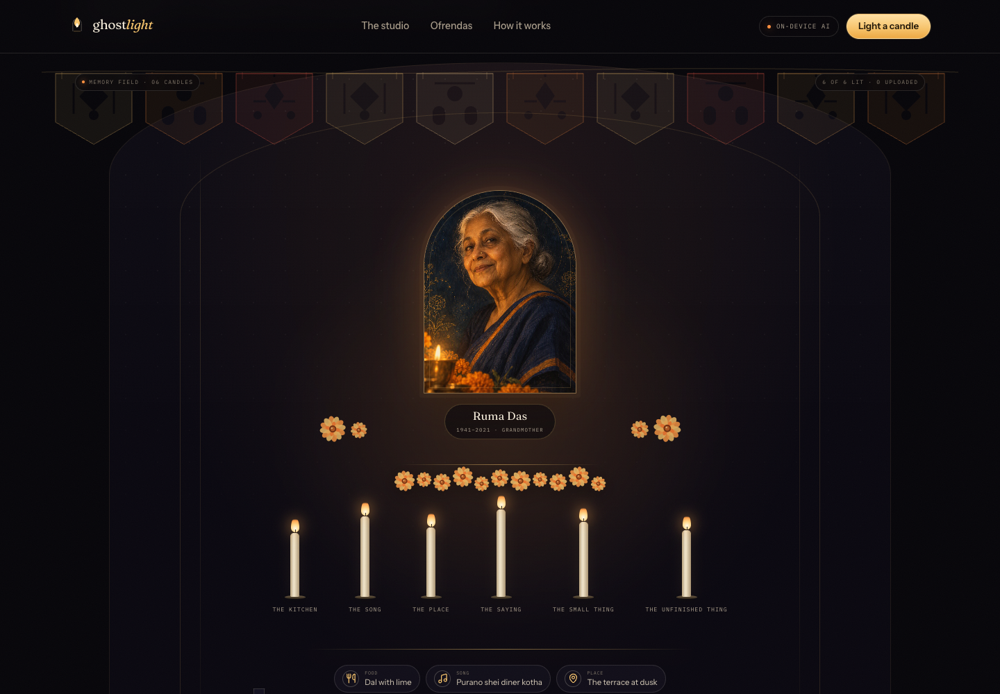
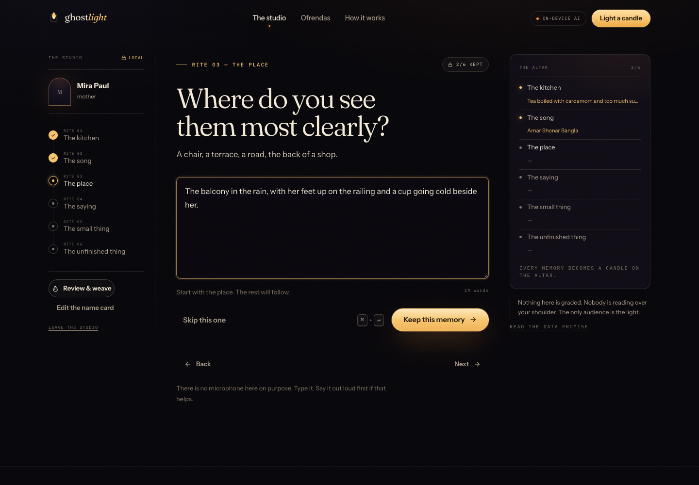
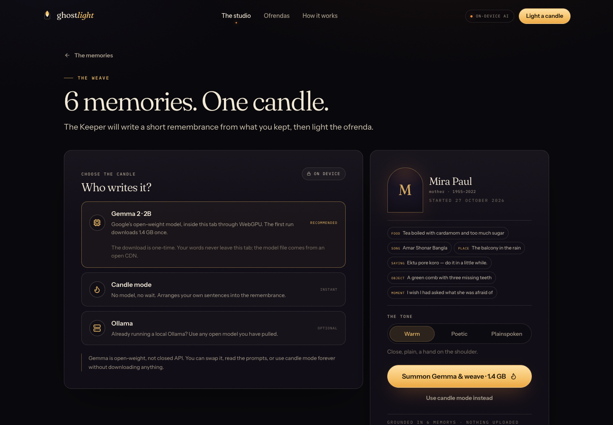
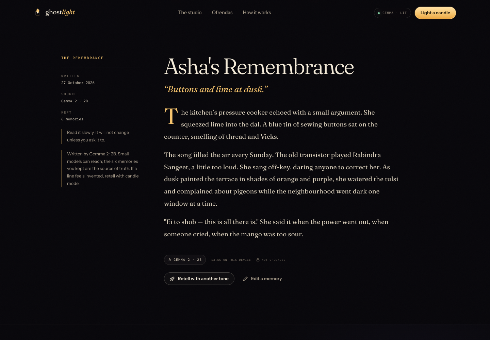
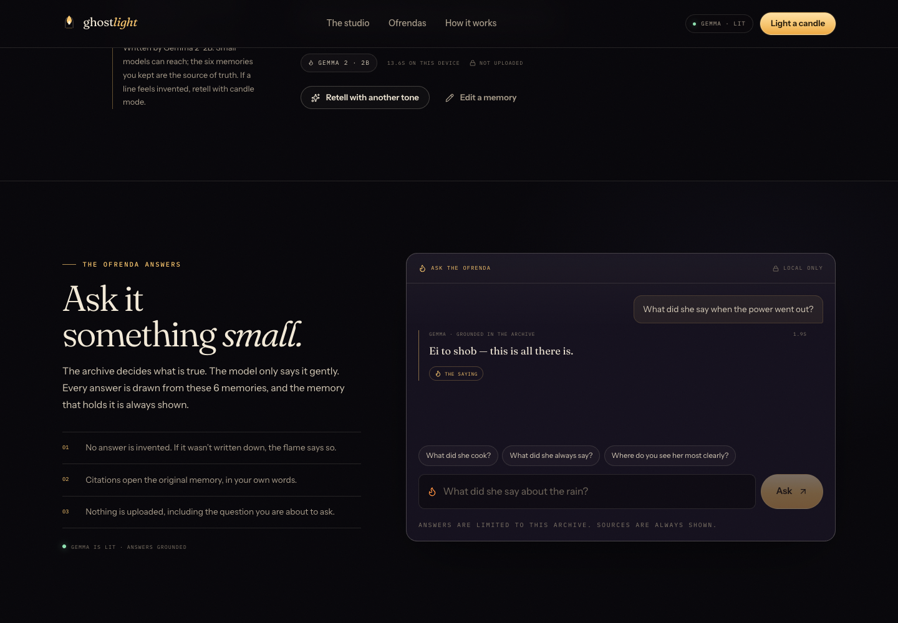
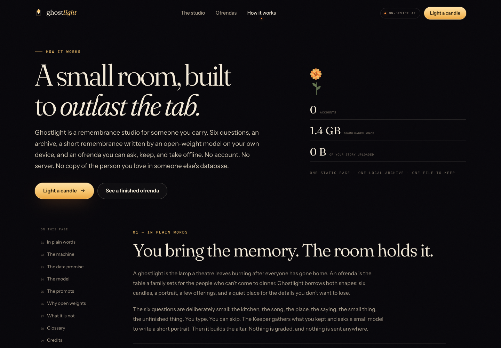
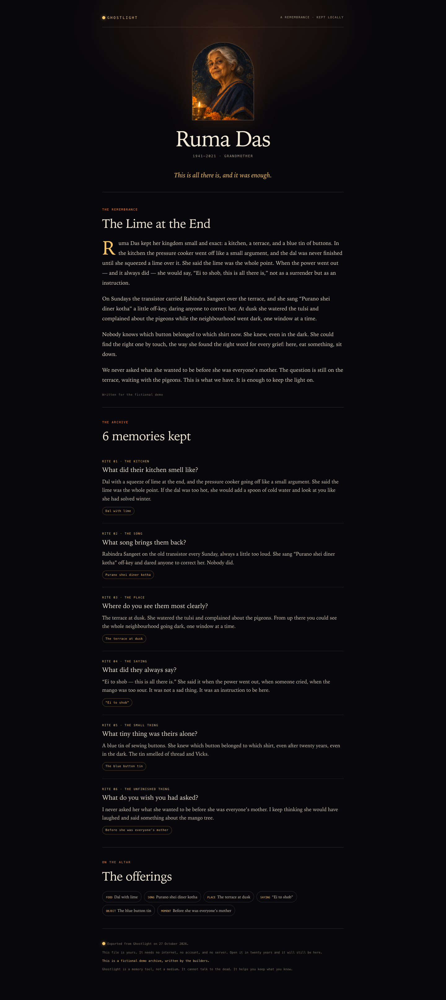

<div align="center">
  
  <h1>Ghostlight</h1>
  <p><em>Keep a light on for the stories that made you.</em></p>
  <p>
    A local-first remembrance studio for Día de Muertos.<br />
    Six questions → a remembrance written by <strong>Gemma 2 in your browser</strong> → an ofrenda
    you can ask, keep, and carry offline.
  </p>
  <p>
    
    
    
    
    
  </p>
</div>

[](docs/screenshots/ofrenda.png)

---

## What this is

Ghostlight asks six small questions about someone you carry — a dish, a song, a place, a saying,
a small thing, an unfinished thing — and turns the answers into three things:

1. **A remembrance.** A short, concrete portrait written from your words.
2. **An ofrenda.** A tiered altar of six candles, marigolds, water and the offerings hiding in
   your answers, inspired by Día de Muertos. Click a lit candle to read its memory.
3. **A keepsake.** A single HTML file that opens offline, needs no app, and contains no scripts.

Everything happens in your browser. An open-weight **Gemma 2 (2B, ~1.4 GB, downloaded once)** runs
through **WebGPU** via **[WebLLM](https://github.com/mlc-ai/web-llm)**; the archive lives in
**IndexedDB**. There is no backend, no account, no analytics, and no cloud inference.

> **The ghost is not the model. The model is the candle. The ghost is what you remember.**

A *ghostlight* is the lamp a theatre leaves burning after everyone has gone home, so the ghosts
have somewhere to be. An *ofrenda* is the table a family sets for the people who can't come to
dinner. Ghostlight borrows both shapes with respect, and claims neither tradition.

---

## Screenshots

| The room | A finished ofrenda |
| --- | --- |
|  |  |

| The studio (six rites) | The weave (choose the candle) |
| --- | --- |
|  |  |

| Gemma 2, live in the browser | Grounded answers with citations |
| --- | --- |
|  |  |

| How it works (plain language + the machine) | The offline keepsake |
| --- | --- |
|  |  |

---

## Features

- **Six rites, then a remembrance.** Type what you remember; skip what is too tender today. The
  Keeper gathers the tastes, songs, places and objects from your answers.
- **On-device writing.** Gemma 2 writes the remembrance in a browser tab. After the one-time
  download it works with the Wi-Fi off.
- **A ghost that refuses to lie.** Questions are answered by retrieval from the archive *first*.
  The model only rephrases what the archive already holds, every answer shows the memory it used,
  and if the answer isn't there, the flame says: *"The flame has no memory of that."*
- **The ofrenda.** Six candles, a portrait, marigolds, water, papel picado, and the offerings from
  your words. Click a candle or an offering to read the original memory.
- **The keepsake.** One self-contained HTML file: the portrait, the remembrance, every memory, the
  offerings. No scripts, no internet, no DRM.
- **Works offline (PWA).** The app shell is precached; the model is cached by WebLLM. Airplane mode
  is enough after the first run.
- **Local archive.** Multiple ofrendas in one room, with JSON import/export and one-click delete.
- **Optional Ollama bridge.** Already run a local Ollama? Use any model you have pulled. Localhost
  only; if it can't connect, the app falls back to memory search — never a cloud API.
- **No microphone, on purpose.** Browser speech APIs often send audio to a vendor. This room ships
  with typing only, so the promise stays true.
- Accessible by default: keyboard operable, visible focus, reduced-motion respected, no colour-only
  meaning.

---

## Quickstart

```bash
git clone https://github.com/soumwadeep/ghostlight.git
cd ghostlight
npm install
npm run dev
```

Open <http://localhost:5173>. There are **no environment variables, no API keys, and no services to
configure**.

On the weave screen you have two honest choices:

- **Summon Gemma 2 · ~1.4 GB.** Runs in the tab through WebGPU (Chrome or Edge on a desktop is the
  smoothest path; roughly 2 GB of free graphics memory). Downloaded once, then cached.
- **Candle mode.** No download, no model, instant. It arranges your own sentences into the
  remembrance and never rewrites them.

The archive and the ofrenda work either way.

```bash
npm test            # 20 unit tests
npm run typecheck   # TypeScript
npm run build       # production build + service worker
npm run verify:gemma # optional: download the model and verify a live weave (writes to /tmp)
```

---

## How the AI works

```
your six answers
   → the archive            (IndexedDB, on this device)
   → memory search          (the archive decides what is true)
   → Gemma 2 · 2B           (WebLLM + WebGPU, in the tab)
   → a remembrance          (150–200 words, in three paragraphs)
   → the ofrenda + a keepsake
```

Two separate AI jobs, with different rules:

| Job | Rule |
| --- | --- |
| **Weave** a remembrance | Write only from the memories, in the third person, with each paragraph assigned to specific memories. Small models can reach; the archive is the source of truth, and candle mode is the strict option. |
| **Answer** a question | Retrieve the memory first. If nothing matches, refuse. If something matches, the model may only rephrase it, and the citation is attached by the app — not chosen by the model. |

The exact prompts are in [`src/lib/ai/prompts.ts`](src/lib/ai/prompts.ts) and are rendered
verbatim on the [How it works](https://github.com/soumwadeep/ghostlight/blob/main/src/pages/About.tsx)
page. Nothing is hidden.

### Model card

| | |
| --- | --- |
| Model | **Gemma 2 · 2B IT** (Google DeepMind, open weights) |
| Identifier | `gemma-2-2b-it-q4f16_1-MLC` |
| Download | ~1.4 GB, once, from the mlc-ai repositories on Hugging Face |
| Runtime | [WebLLM](https://github.com/mlc-ai/web-llm) (Apache-2.0) on WebGPU |
| Memory | about 2 GB of free graphics memory |
| Licence | [Gemma Terms of Use](https://ai.google.dev/gemma/terms) |
| Cold start | in our test: 1.4 GB in ~2 minutes, then a remembrance in 13.6 s on-device |

> **A note on Gemma 3.** WebLLM 0.2.86's prebuilt `gemma3-1b-it` record cannot load
> (upstream [issue #873](https://github.com/mlc-ai/web-llm/issues/873)), and the suggested config
> fix produces garbage. Ghostlight therefore ships **Gemma 2 2B**, which runs correctly. The model
> id is one line in [`src/lib/ai/webllm.ts`](src/lib/ai/webllm.ts); when the Gemma 3 build is fixed,
> swapping is trivial.

### The optional Ollama bridge

```bash
ollama pull gemma2:9b        # or any model you like
OLLAMA_ORIGINS=* ollama serve
```

Then choose **Ollama** on the weave screen and scan. This is intended for local development: a
hosted HTTPS page may not be allowed to call `http://127.0.0.1`. If the request fails, the app never
reaches for a cloud service — it falls back to memory search.

---

## Privacy (the data promise)

Local-first is a promise with edges, so here are ours.

| Leaves this device | Never leaves this device |
| --- | --- |
| A request for the static page (any host sees this) | Your six answers |
| One model download from an open CDN | Your photograph (resized in a canvas, stored locally) |
| — | The questions you ask the ofrenda |
| — | The remembrance and the keepsake |

- No account, no email, no analytics, no tracking pixels.
- No microphone (see above).
- Clearing this browser's site data deletes the archive. Export what you can't lose.
- What we **can't** promise: protection from a shared computer, a browser extension, or someone
  holding your unlocked device. Local-first is not magic; it is a smaller, clearer perimeter.

---

## Deploy

The build is a plain static site (`dist/`). No server is required for anything the app does.

**Render (one click, free tier, and the model runs in the visitor's browser):**

[](https://render.com/deploy?repo=https://github.com/soumwadeep/ghostlight)

The blueprint in [`render.yaml`](render.yaml) builds with `npm ci && npm run build`, serves `./dist`,
and adds the SPA rewrites the client-side routes need (`/studio`, `/ofrenda/*`, `/archive`,
`/about`). Hosting does not change privacy: the host sees page requests, never the archive.

**A `.tech` domain:** claim the free first-year domain from the Hacktoberfest promos, then add it as
a custom domain on the Render service (Render provides the DNS records and issues HTTPS). No code
changes are needed.

Any other static host works too — just make sure unknown paths rewrite to `index.html`.

---

## Tests and verification

```bash
npm test         # 20 tests: prompt parsing, candle-mode weaving, retrieval + refusals,
                 # keepsake escaping, slug/escape/count utilities
npm run typecheck
npm run build
```

The live model was verified end-to-end on a desktop Chrome with WebGPU: the model downloaded once,
the studio produced a remembrance on-device, and the ofrenda answered a question from the archive
with a citation. See [`docs/VERIFICATION.md`](docs/VERIFICATION.md) for the environment, timings,
the raw generated text, and screenshots.

---

## Repository map

```
src/
  pages/         Landing · Studio · OfrendaPage · ArchivePage · About
  components/    GhostlightOrb · OfrendaScene · MemoryDialog · AskPanel · PapelPicado …
  lib/ai/        prompts · retrieval (grounding + refusals) · candle · weave · ask · webllm · ollama · parse
  lib/           archive (context) · storage (IndexedDB) · keepsake · model (WebGPU state) · factory · utils
  data/          chapters (the six rites) · demo (a fictional archive)
  styles/        tokens · base · ui · layout · landing · studio · ofrenda · pages
docs/            dev-post.md (submission draft) · VERIFICATION.md · gemma-result.txt · screenshots/
public/          icons · og.png · robots.txt · demo/ruma.jpg (a generated, fictional portrait)
```

Stack: React 19, Vite 8, TypeScript 6, `motion`, `lucide-react`, `idb-keyval`,
`@mlc-ai/web-llm`, `vite-plugin-pwa`, and the OFL typefaces Fraunces, Instrument Sans and IBM Plex
Mono. No backend, no database service, no auth provider, no API key.

---

## Honest edges

- **WebGPU is required** for the in-browser model (desktop Chrome or Edge is the smoothest). Without
  it, candle mode works everywhere.
- **~1.4 GB, once.** After that the room is offline.
- **A 2B model is small.** It writes plainly and can occasionally reach for a detail that isn't in
  the archive. That is why the memories are always visible, why the app has a strict candle mode,
  and why the reading says so out loud.
- **The demo archive is fictional.** Ruma Das is not a real person; the portrait was generated for
  this project, and the demo memories were written by the builders. The finished demo remembrance is
  a hand-written target, not a model output.
- **Not a medium, not therapy.** Ghostlight cannot talk to the dead, clone a voice, or replace grief
  counselling or a family's own rituals. It is a place to put words.
- **Not affiliated** with Google, MLC AI, or the Hacktoberfest organizers.

---

## Credits

Made for the **Hacktoberfest 2026 DEV Challenge — Ghost in the Machine**. With Gemma 2 by Google
DeepMind, WebLLM by MLC AI, React and Vite, Lucide icons, and the open-source fonts Fraunces,
Instrument Sans and IBM Plex Mono. The ofrenda is a living tradition from Mexico; this project
borrows its shape with respect.

MIT licensed. The code, the prompts and the design are yours to fork; the words are the user's.
Read the [submission draft](docs/dev-post.md) · [open an issue](https://github.com/soumwadeep/ghostlight/issues).